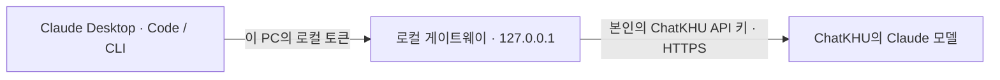
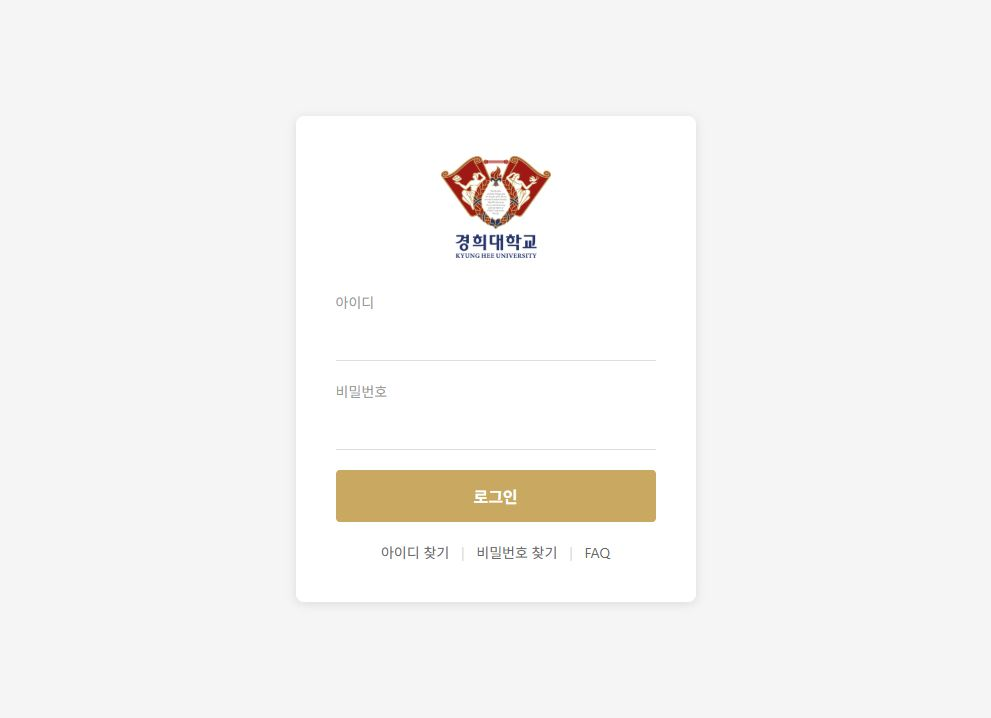
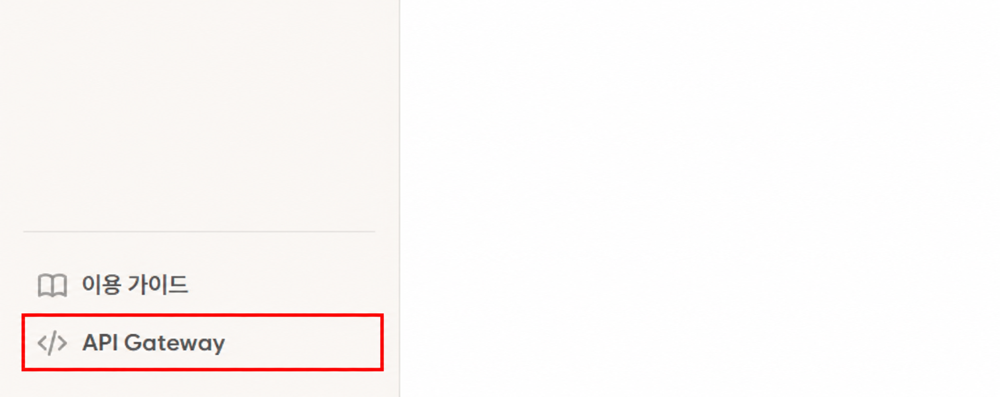
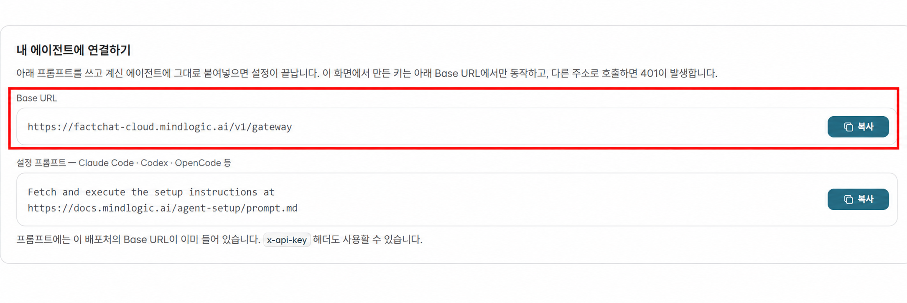
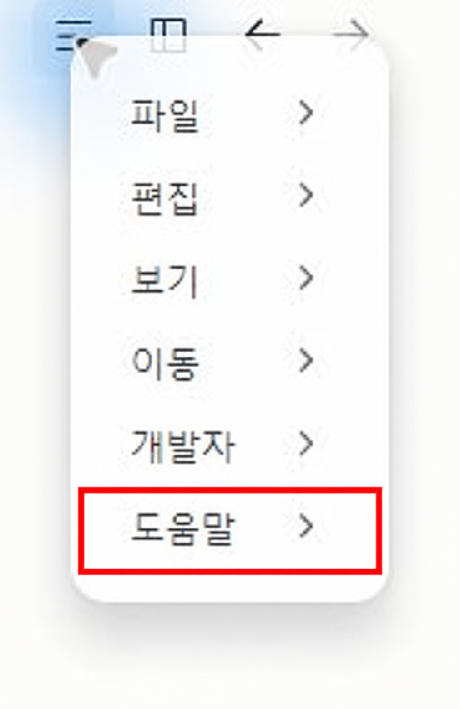
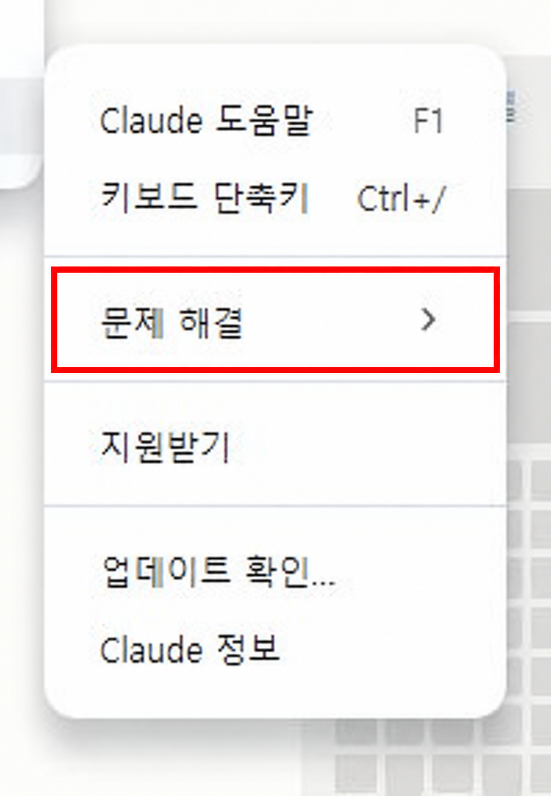
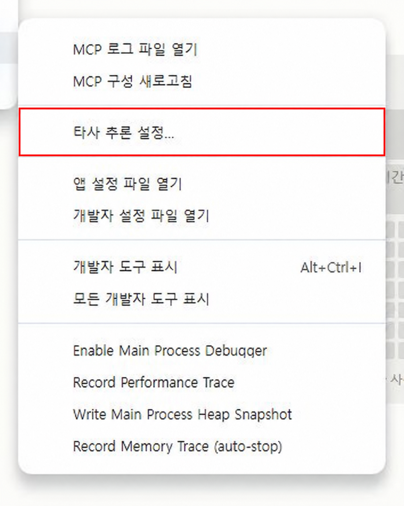
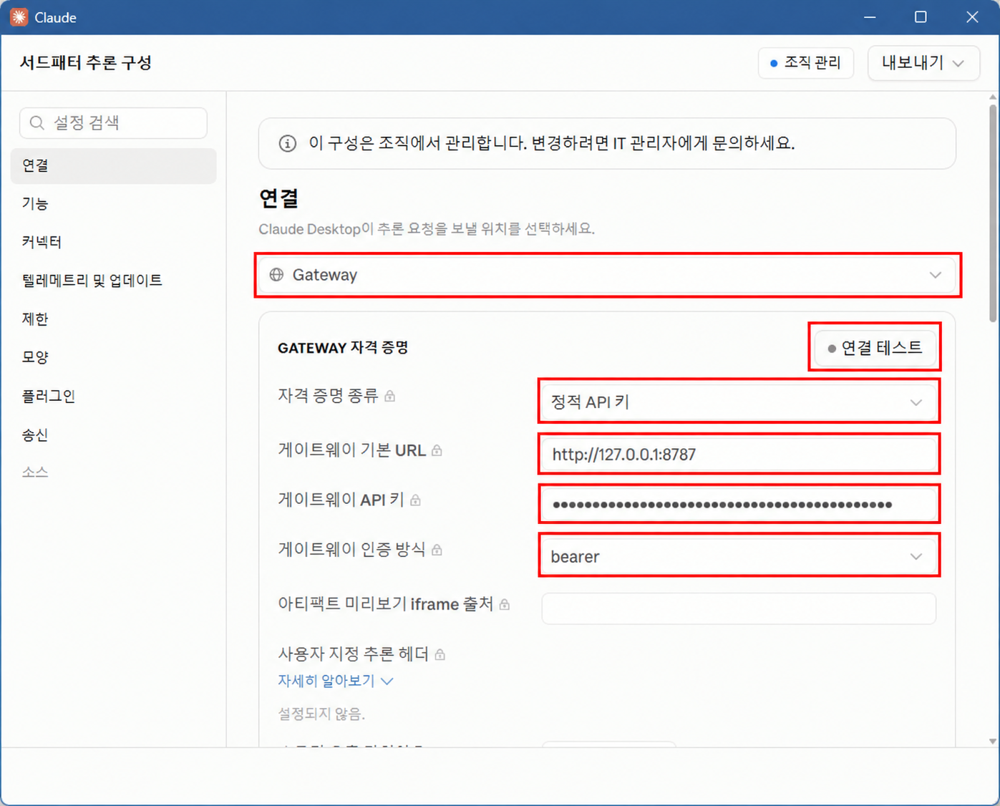
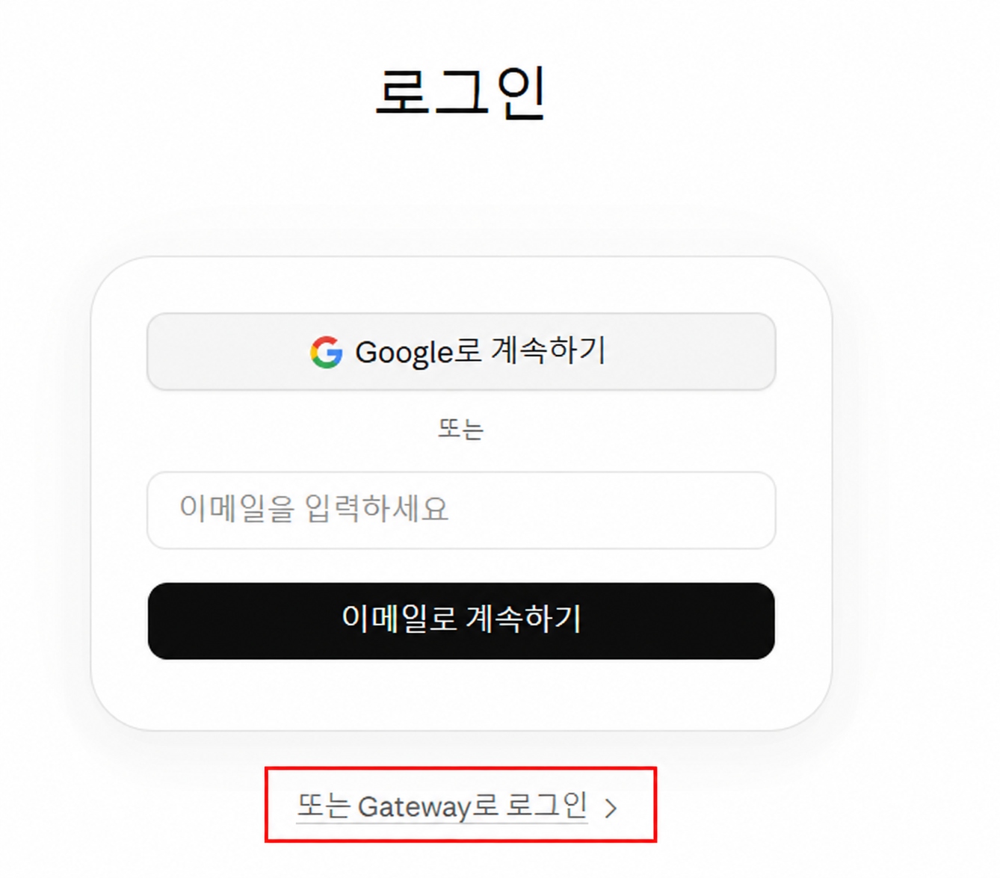

# 챗쿠 게이트웨이

**Claude Code와 ChatKHU(챗쿠)를 이어 주는 내 PC용 연결 도구입니다.** ChatKHU에서 발급받은 본인의 API 키를 등록하면, Claude Desktop의 Code 화면이나 Claude Code CLI에서 보낸 요청을 ChatKHU의 Claude 모델로 전달합니다. API 사용량과 크레딧은 키를 발급한 본인 계정에 반영됩니다.

처음에는 **개인 API 키 등록 → 로컬 게이트웨이 실행 → Claude 앱 연결** 순서로 설정합니다. 설정을 마친 뒤에는 게이트웨이를 켜고 Claude 앱을 사용하면 됩니다.

이 안내는 **Windows의 Claude Desktop 앱**을 처음 연결하는 순서로 작성했습니다. 화면에 있는 메뉴 이름은 **개발자 모드**(Developer Mode)와 **타사 추론 설정**(Configure Third-Party Inference)입니다. 터미널에서 쓰는 CLI 방법은 [별도 절](#터미널에서-claude-code-cli-사용하기)에 있습니다.



**확인일: 2026-10-08.** Windows / Node.js 22.17.0 / Claude Code CLI 2.1.280 / Claude Desktop 2.26454.2.0에서 검증했습니다. Desktop에서는 Gateway 로그인, 모델 조회, Haiku 4.5의 실제 응답을 확인했습니다. 캡처는 해당 버전의 화면이며, 업데이트에 따라 메뉴 문구와 배치가 달라질 수 있습니다. [검증 결과](docs/VALIDATION.md)

**사진의 빨간 박스는 눌러야 할 메뉴나 확인할 입력란입니다.** 실제 캡처를 바탕으로 강조 표시를 추가했습니다. 각 단계의 **완료 확인**까지 확인한 뒤 다음으로 넘어가세요. [원본 캡처와 편집 기록](docs/images/setup/README.md)

## 안내 순서

1. [준비물 확인](#1-준비물-확인)
2. [ChatKHU에서 본인 API 키 발급](#2-chatkhu에서-본인-api-키-발급)
3. [게이트웨이 내려받기](#3-게이트웨이-내려받기)
4. [개인 API 키와 모델 설정](#4-개인-api-키와-모델-설정)
5. [Desktop용 토큰 준비와 서버 실행](#5-desktop용-토큰-준비와-서버-실행)
6. [Claude 개발자 모드 활성화](#6-claude-개발자-모드-활성화)
7. [타사 추론 설정에 Gateway 연결](#7-타사-추론-설정에-gateway-연결)
8. [Gateway 로그인과 첫 대화](#8-gateway-로그인과-첫-대화)
9. [다음에 다시 실행하는 방법](#9-다음에-다시-실행하는-방법)
10. [막히는 경우](#10-막히는-경우)

## 1. 준비물 확인

| 준비물 | 설명 |
| --- | --- |
| 본인의 ChatKHU 계정 | [ChatKHU](https://chat.khu.ac.kr/)에 로그인할 수 있어야 합니다. 계정에서 Gateway·Claude 모델 사용이 허용되어 있어야 합니다. |
| 개인 API 키 | 다음 단계에서 발급합니다. API 사용 크레딧은 키를 만든 계정에서 차감됩니다. |
| Claude Desktop | [공식 다운로드](https://claude.com/download)에서 Windows 앱을 설치합니다. 브라우저의 claude.ai 화면과 구분해 주세요. |
| Node.js 22 이상과 npm | [Node.js 다운로드](https://nodejs.org/en/download)에서 설치합니다. npm은 Node.js 설치에 포함됩니다. |
| Git | 아래 clone 명령을 사용할 때 필요합니다. [Git for Windows](https://git-scm.com/downloads/win) |
| 이 저장소의 구현 파일 | 저장소는 비공개이므로 접근 권한이 필요합니다. `package.json`, `bin/`, `src/`가 포함된 버전을 받으세요. |

앱에서만 사용할 경우 별도의 Claude Code CLI 설치는 필수가 아닙니다. `npm run claude`로 터미널에서 사용하려면 [공식 CLI](https://code.claude.com/docs/en/setup)를 추가로 설치하세요. 이 게이트웨이가 Claude 앱이나 CLI를 대신 설치하지는 않습니다.

프로그램 설치 후 **PowerShell을 새로 열고** 다음 명령이 버전을 출력하는지 확인합니다.

```powershell
node --version
npm --version
git --version
```

**완료 확인:** 세 명령에서 버전이 나오고 Claude Desktop 앱이 열리면 준비됐습니다.

## 2. ChatKHU에서 본인 API 키 발급

### 2-1. ChatKHU 로그인

1. [ChatKHU 홈페이지](https://chat.khu.ac.kr/)를 엽니다.
2. **입장하기**를 누르고 학교 계정으로 로그인합니다.
3. 경희대학교 로그인 화면이 나타나면 본인의 인포21 계정을 사용합니다. [학교의 접속 안내](https://human.khu.ac.kr/human_kor/user/bbs/BMSR00040/view.do?boardId=528001&menuNo=15800019)



### 2-2. 왼쪽 아래에서 API Gateway 열기

로그인한 화면의 왼쪽 아래에서 **API Gateway**를 누릅니다. 화면이 좁아 메뉴가 보이지 않으면 먼저 사이드바를 펼쳐 주세요.



### 2-3. API 키 생성 버튼 누르기

**API 키 관리** 영역의 **API 키 생성**을 누르고 화면 안내에 따라 본인 키를 발급합니다. 해당 영역이 보이지 않으면 아래로 스크롤하세요.


발급된 키를 복사해 본인만 접근할 수 있는 곳에 보관합니다. **발급 화면을 닫으면 전체 키를 다시 조회할 수 없으므로 저장을 마친 뒤 닫으세요.** 키 발급 절차는 [ChatKHU 공식 인증 안내](https://docs.mindlogic.ai/docs/khu/api-gateway/getting-started/authentication)를 참고했습니다.

### 2-4. 같은 화면에서 Base URL 확인하기

**내 에이전트에 연결하기** 카드의 **Base URL**을 확인합니다. 오른쪽 복사 버튼으로 주소를 복사할 수 있습니다. 아래 사진의 빨간 박스 안에 있는 주소를 사용하세요.



촬영한 ChatKHU 화면의 Base URL은 다음과 같습니다. **본인 계정 화면의 주소를 우선** 사용하세요. [Base URL 카드의 공식 안내](https://docs.mindlogic.ai/docs/general/baze/product/api-access#내-에이전트-연결)

```text
https://factchat-cloud.mindlogic.ai/v1/gateway
```

이 주소를 4단계에서 입력하면 도구가 Claude용 경로인 `/claude`를 자동으로 붙입니다. 이미 `/gateway/claude`까지 있는 주소도 사용할 수 있습니다. `/claude/v1` 또는 `/messages`까지 붙여 입력하지 마세요. 키를 발급한 기관과 다른 주소를 사용하면 인증에 실패할 수 있습니다.

**개인 키는 4단계의 터미널 숨김 입력란에 붙여넣습니다.** 키가 포함된 설정 프롬프트나 화면을 채팅·README·GitHub에 올리지 마세요.

**완료 확인:** 본인의 API 키와 Base URL 두 가지를 준비했으면 다음으로 넘어갑니다. 위 캡처에는 개인 키·기존 키 목록·계정 사용량을 포함하지 않았습니다.

## 3. 게이트웨이 내려받기

PowerShell에 아래 명령을 차례대로 입력합니다. 사용자 폴더 아래에 `chatkhu-claude-gateway` 폴더가 만들어집니다.

```powershell
$chatkhuProject = Join-Path $env:USERPROFILE 'chatkhu-claude-gateway'
git clone https://github.com/205sla/chatkhu-claude-gateway.git $chatkhuProject
Set-Location -LiteralPath $chatkhuProject
npm ci --ignore-scripts --no-audit --no-fund
```

이미 폴더를 전달받았다면 clone은 생략하고 **`package.json`이 있는 폴더**에서 마지막 `npm ci` 명령부터 실행합니다. 저장소 접근 오류는 GitHub 초대·로그인 상태를 확인하세요. 런타임 외부 의존성은 없으며 별도 빌드도 필요하지 않습니다.

**완료 확인:** `npm ci`가 오류 없이 끝나고 PowerShell 입력 프롬프트가 다시 나타나면 됩니다. 이 창을 그대로 사용하세요.

## 4. 개인 API 키와 모델 설정

같은 PowerShell에서 실행합니다.

```powershell
npm run setup
```

| 터미널의 질문 | 입력할 내용 |
| --- | --- |
| `계정 Base URL` | 2단계에서 확인한 ChatKHU 주소. 표시된 기본 주소와 같으면 Enter |
| `개인 ChatKHU API 키` | 본인이 발급한 API 키를 붙여넣고 Enter |
| `모델 번호 또는 실제 ID` | 조회된 목록에서 사용할 Claude 모델의 번호 또는 ID |

**키를 붙여넣어도 글자나 별표가 보이지 않는 것이 정상입니다.** 붙여넣기 후 Enter를 누르세요. 다른 입력란에 시험 삼아 키를 표시할 필요는 없습니다.

모델은 실제로 조회된 목록에서 선택합니다. 이 PC에서는 `claude-haiku-4-5-20251001`로 테스트했지만 계정별로 허용 목록이 다를 수 있습니다. 설정이 끝나면 다음 명령으로 목록을 다시 확인할 수 있습니다.

```powershell
npm run models
```

`setup`과 `models`는 생성 요청을 보내지 않습니다. `setup`에서 보이는 `opus → Haiku` 같은 별칭은 **CLI의 연결 대상**입니다. `opus`라고 입력해도 Haiku에 매핑되어 있으면 실제 호출은 Haiku입니다. Desktop에서는 나중에 앱의 모델 선택기에서 모델을 고릅니다.

**완료 확인:** 설정이 저장되고 `npm run models`에서 본인 계정의 모델 목록이 나오면 API 키와 주소 확인을 마친 것입니다.

## 5. Desktop용 토큰 준비와 서버 실행

### 5-1. 두 종류의 키를 구분하세요

| 값 | 넣는 곳 | 용도 |
| --- | --- | --- |
| **ChatKHU 개인 API 키** | 앞 단계의 `npm run setup` | 게이트웨이가 본인의 ChatKHU 계정으로 요청 |
| **로컬 토큰** | Claude 앱의 `게이트웨이 API 키` 칸 | Claude 앱이 이 PC의 게이트웨이에 접속 |

이 안내에서는 Claude 앱에 **로컬 토큰**을 넣습니다. ChatKHU 개인 키를 로컬 주소의 인증값으로 넣으면 연결되지 않습니다.

### 5-2. 로컬 토큰 파일을 처음 한 번 준비

저장소 폴더의 PowerShell에서 **아래 블록 전체를 한 번에** 붙여넣습니다. 새 토큰을 안전한 난수로 만들고 사용자 전용 파일에 저장합니다. 이미 토큰 파일이 있으면 그대로 유지하며 값을 화면에 출력하지 않습니다.

```powershell
$env:CHATKHU_LOCAL_TOKEN_FILE = Join-Path $env:LOCALAPPDATA 'chatkhu-gateway\desktop\local-token.key'
@'
import { access } from 'node:fs/promises';
import { newToken } from './src/gateway.mjs';
import { writePrivate } from './src/private-files.mjs';

const tokenPath = process.env.CHATKHU_LOCAL_TOKEN_FILE;
if (!tokenPath) throw new Error('CHATKHU_LOCAL_TOKEN_FILE is required.');
try {
  await access(tokenPath);
  console.log('Existing Desktop local token kept.');
} catch (error) {
  if (error.code !== 'ENOENT') throw error;
  await writePrivate(tokenPath, newToken(), { exclusive: true });
  console.log('Desktop local token created.');
}
'@ | node --input-type=module
```

`Desktop local token created.`는 새 파일을 만들었다는 뜻이고, `Existing Desktop local token kept.`는 기존 파일을 유지했다는 뜻입니다. 둘 중 하나가 나오면 다음으로 진행합니다. 이 파일은 ChatKHU API 키 파일과 별개입니다.

### 5-3. 게이트웨이 실행

**같은 PowerShell 창 A**에서 실행합니다.

```powershell
npm run serve -- --port 8787
```

정상 시작 시 다음 주소와 임시 클라이언트 설정 파일의 경로가 표시됩니다.

```text
게이트웨이: http://127.0.0.1:8787 | health: http://127.0.0.1:8787/health
로컬 클라이언트 설정 파일: …\sessions\session-…\client-env.json
```

**창 A를 켜 두세요.** 서버가 실행 중이어서 입력 프롬프트가 돌아오지 않는 것이 정상입니다. 이 창을 닫거나 Ctrl+C를 누르면 앱의 Gateway 연결도 끊깁니다.

상태를 확인하려면 **별도의 PowerShell 창 B**에서 실행합니다.

```powershell
Invoke-RestMethod 'http://127.0.0.1:8787/health'
```

`status`가 `ok`이면 로컬 서버가 응답하고 있습니다. 이 확인만으로 실제 모델 응답까지 검증된 것은 아닙니다.

**완료 확인:** 창 A는 서버 실행 상태로 두고, 창 B에서 `status: ok`를 확인했습니다. 이제 Claude 앱을 설정합니다.

## 6. Claude 개발자 모드 활성화

이 단계는 **Claude Desktop 앱 안에서** 진행합니다. Windows 자체 개발자 모드를 켜는 절차와는 다릅니다.

### 6-1. 앱 메뉴에서 도움말 열기

Claude 앱을 열고 왼쪽 위 **☰ 앱 메뉴 → 도움말**(Help)을 선택합니다. 처음 실행한 **로그인 화면에서도** 설정을 시작할 수 있습니다.



### 6-2. 문제 해결에서 개발자 모드 활성화

**문제 해결**(Troubleshooting)을 열고 하위 메뉴에서 **개발자 모드 활성화**(Enable Developer Mode)를 선택합니다. 앱의 안내에 따라 재시작합니다.



**이미 개발자 메뉴가 보이면 활성화는 끝난 상태입니다.** 위 사진은 개발자 모드가 이미 켜진 PC에서 촬영한 것으로, `문제 해결`의 위치를 보여 줍니다. 활성화 버튼 자체를 촬영한 사진은 아닙니다. 메뉴가 다르게 보이면 앱 버전과 [Anthropic의 개발자 모드 안내](https://claude.com/docs/third-party/claude-desktop/in-app-configuration)를 확인하세요.

### 6-3. 개발자 메뉴에서 타사 추론 설정 열기

앱 메뉴를 다시 열어 **개발자 → 타사 추론 설정**을 선택합니다. 영어 화면에서는 **Developer → Configure Third-Party Inference**로 표시됩니다.



**완료 확인:** `타사 추론 설정` 창이 열리면 다음 단계로 진행합니다.

## 7. 타사 추론 설정에 Gateway 연결

### 7-1. 앱에 넣을 로컬 토큰 복사

5단계에서 연 **PowerShell 창 B**에서 아래 명령을 실행합니다. 토큰이 콘솔에 표시되지 않고 클립보드에 복사됩니다.

```powershell
$chatkhuTokenPath = Join-Path $env:LOCALAPPDATA 'chatkhu-gateway\desktop\local-token.key'
Set-Clipboard -Value ((Get-Content -Raw -LiteralPath $chatkhuTokenPath).Trim())
```

복사한 값은 다음 단계에서 Claude의 **게이트웨이 API 키** 칸에 붙여넣습니다. `Bearer `라는 글자는 앞에 붙이지 않습니다.

### 7-2. 연결 항목 입력

설정 창의 왼쪽에서 **연결**을 선택하고 아래와 같이 입력합니다.

| 화면 항목 | 입력·선택할 값 |
| --- | --- |
| 추론 제공자 | `Gateway` |
| 자격 증명 종류 | `정적 API 키` / `Static API key` |
| 게이트웨이 기본 URL | `http://127.0.0.1:8787` |
| 게이트웨이 API 키 | 방금 복사한 **로컬 토큰** |
| 게이트웨이 인증 방식 | `bearer` |
| 사용자 지정 추론 헤더 등 나머지 항목 | 이 안내에서는 추가하지 않음 |



사진에서 **Gateway부터 bearer까지 입력란을 채운 뒤 연결 테스트**를 누릅니다. **앱의 기본 URL**은 `http://127.0.0.1:8787`입니다. 2단계에서 복사한 ChatKHU의 HTTPS 주소는 4단계의 `setup`에 사용합니다.

**캡처의 읽기 전용 표시에 관하여:** 촬영한 PC에는 기존 관리 설정이 있어 `조직 관리`가 표시됩니다. 관리 설정이 없는 개인 PC에서는 값을 입력하고 적용할 수 있습니다. 같은 읽기 전용 안내가 나온다면 [아래 문제 해결](#10-막히는-경우)을 먼저 확인하세요.

### 7-3. 연결 확인 후 적용

1. PowerShell 창 A의 게이트웨이가 실행 중인지 확인합니다.
2. **연결 테스트**(Test Connection)로 주소와 인증을 확인합니다.
3. **Apply Changes**(변경 사항 적용)를 눌러 이 PC에 적용하고 앱을 다시 시작합니다. 조직 배포용 `내보내기`는 개인 PC의 기본 연결 절차에 필요하지 않습니다.
4. 붙여넣기를 마쳤다면 창 B에서 `Set-Clipboard -Value ''`로 클립보드를 비울 수 있습니다.

연결 테스트나 앱의 자동 연결 확인에서 실제 모델 요청이 발생할 수 있습니다. 크레딧 사용량은 본인의 ChatKHU 계정에서 확인하세요. 설정 필드와 적용 방식은 [Gateway 문서](https://claude.com/docs/third-party/claude-desktop/gateway), [앱 내 설정 문서](https://claude.com/docs/third-party/claude-desktop/in-app-configuration)를 참고했습니다.

**완료 확인:** 연결 설정이 적용되고 Claude 앱이 다시 열렸으면 Gateway로 로그인합니다.

## 8. Gateway 로그인과 첫 대화

앱 로그인 화면 아래의 **또는 Gateway로 로그인**을 누릅니다. 이미 Gateway 화면으로 들어가 있다면 로그인 단계는 건너뜁니다.



이 캡처는 사용자가 제공한 실제 로그인 화면입니다. Google·이메일 입력란 아래에 있는 Gateway 링크를 찾으세요.

연결 후에는 다음 순서로 첫 응답을 확인합니다.

1. **Code** 화면으로 이동합니다.
2. **로컬** 환경과 사용할 작업 폴더를 선택합니다. 처음 확인할 때는 빈 연습 폴더를 사용해도 됩니다.
3. 모델 선택기에서 계정에 표시된 Claude 모델을 선택합니다. 검증에는 **Haiku 4.5**를 사용했습니다.
4. 아래 문구를 보내고 응답을 확인합니다. 실제 생성 요청이므로 계정 크레딧을 사용합니다.

```text
연결 확인 테스트입니다. 도구를 사용하거나 파일을 읽거나 수정하지 말고, 정확히 CHATKHU_DESKTOP_OK 한 줄만 답해 주세요.
```

이 PC에서는 `CHATKHU_DESKTOP_OK` 응답과 모델 조회·Messages·토큰 계산 HTTP 200을 확인했습니다. 모델 목록의 개수와 구성은 계정·시점에 따라 달라집니다. 모델에게 자기 이름을 물어본 답만으로 실제 모델 ID를 판정하지는 마세요. [실제 연결 기록](docs/DESKTOP_GATEWAY_SETUP_2026-10-08.md)

작업 폴더나 도구 사용 승인은 내용을 확인하고 선택하세요. Gateway 연결을 위해 `권한 무시` 같은 실행 모드를 켤 필요는 없습니다.

**완료 확인:** 선택한 모델에서 `CHATKHU_DESKTOP_OK` 응답이 오면 첫 연결을 마쳤습니다. 다음부터는 아래 9단계로 시작하면 됩니다.

## 9. 다음에 다시 실행하는 방법

키 발급, `setup`, 로컬 토큰 생성, 개발자 모드 활성화는 매번 반복하지 않습니다. 이 안내의 기본 위치에 설치했다면 새 PowerShell에서 다음만 실행합니다.

```powershell
Set-Location -LiteralPath (Join-Path $env:USERPROFILE 'chatkhu-claude-gateway')
$env:CHATKHU_LOCAL_TOKEN_FILE = Join-Path $env:LOCALAPPDATA 'chatkhu-gateway\desktop\local-token.key'
npm run serve -- --port 8787
```

다른 곳에 내려받았다면 첫 줄의 폴더만 실제 위치로 바꿉니다. 서버가 켜진 뒤 Claude 앱을 여세요. **같은 포트와 같은 토큰 파일**을 사용해야 앱에 저장된 연결과 일치합니다.

종료할 때는 작업을 마친 뒤 서버를 실행한 PowerShell에서 Ctrl+C를 누릅니다. 서비스·자동 시작은 등록하지 않으므로 PC를 재부팅한 후 서버도 다시 실행해야 합니다. [자세한 운영·복구 방법](docs/OPERATIONS.md)

## 10. 막히는 경우

| 증상 | 확인할 사항 |
| --- | --- |
| `node`, `npm`, `git` 명령을 찾지 못함 | 해당 프로그램을 설치하고 PowerShell을 새로 엽니다. |
| `npm.ps1`을 실행할 수 없다는 오류 | 같은 명령의 `npm`을 `npm.cmd`로 바꿔 실행할 수 있습니다. 예: `npm.cmd run setup` |
| 저장소 접근 거절 또는 `package.json` 없음 | GitHub 접근 권한과 구현 파일이 포함된 버전인지 확인합니다. `package.json`이 있는 폴더에서 실행합니다. |
| ChatKHU에 API Gateway 메뉴·Claude 모델이 없음 | 계정·기관의 사용 권한을 담당자에게 확인합니다. 다른 사람의 키로 대신 연결하지 않습니다. |
| 키를 붙여넣어도 화면에 아무것도 안 보임 | `setup`의 숨김 입력은 정상입니다. 붙여넣고 Enter를 누릅니다. |
| `npm run models`에서 인증 실패 | 본인 키가 맞는지, 키를 발급한 화면과 Base URL의 기관이 같은지 확인합니다. |
| `/health`에 연결할 수 없음 | PowerShell 창 A에서 서버가 실행 중인지, 주소가 `127.0.0.1:8787`인지 확인합니다. |
| `EADDRINUSE` 또는 8787 포트 충돌 | 이미 실행 중인 서버인지 먼저 확인합니다. 포트를 바꾸려면 서버의 `--port`와 앱의 기본 URL을 함께 바꿉니다. |
| 개발자 메뉴가 없음 | **도움말 → 문제 해결 → 개발자 모드 활성화** 후 재시작합니다. 최신 앱의 공식 안내도 확인합니다. |
| Gateway 설정 창이 읽기 전용·조직 관리로 표시됨 | 기존 관리 프로필이나 정책이 우선 적용된 상태입니다. 관리자는 원래 연결 설정을 확인해야 합니다. 이 안내의 설정을 저장하려고 기존 정책을 일괄 삭제하지 마세요. |
| 앱에 API 키 오류가 표시되지만 `models`는 성공 | 앱에는 **로컬 토큰**, setup에는 **ChatKHU 키**를 넣었는지 구분합니다. 서버 시작 시 같은 `CHATKHU_LOCAL_TOKEN_FILE`을 지정했는지도 확인합니다. |
| 이전 주소가 계속 표시됨 | Windows MSIX 앱은 일반 HKCU와 앱 컨텍스트의 설정이 다를 수 있습니다. 이 PC의 사례는 [상세 기록](docs/DESKTOP_GATEWAY_SETUP_2026-10-08.md)에 있습니다. |
| 연결은 복구됐지만 모델 선택이 비활성화됨 | 서버를 켠 상태에서 Claude 앱을 정상 종료한 뒤 다시 엽니다. |
| HTTP 402 / 429 | 각각 계정 크레딧 또는 사용 제한을 확인합니다. 반복 전송으로 해결하려 하지 않습니다. |
| HTTP 400 / 403 | 조직 모델 권한·Gateway 설정·콘텐츠 필터 또는 로컬 요청 조건을 구분해야 합니다. [오류별 조치](docs/OPERATIONS.md#오류별-조치)를 확인합니다. |

새 개인 PC의 기본 경로는 앱의 설정 화면에서 적용하는 방법입니다. 이 PC에서 했던 레지스트리·MSIX 변경은 **기존 Kiro 연결이 남아 있던 환경의 개별 복구 사례**이며, 모든 사용자에게 필요한 설치 단계는 아닙니다.

## 터미널에서 Claude Code CLI 사용하기

앱 대신 터미널을 사용하려면 1~4단계까지 마친 뒤 [공식 Claude Code CLI](https://code.claude.com/docs/en/setup)를 설치하고 실행합니다. Desktop의 개발자 모드나 Gateway 로그인 화면은 CLI 설정에 필요하지 않습니다.

```powershell
claude --version
npm run doctor
npm run claude
```

`doctor`는 CLI 설치·설정 충돌도 검사합니다. Desktop만 설치한 PC에서는 `Claude Code 설치` 항목이 실패할 수 있으며, 그 결과만으로 Desktop 연결 실패를 뜻하지는 않습니다.

CLI 안에서 `/status`를 입력해 `Anthropic base URL`이 이번 실행의 `http://127.0.0.1:포트`, 인증 출처가 `ANTHROPIC_AUTH_TOKEN`, 모델이 선택한 실제 ID인지 확인하세요. 이 실행기는 임시 설정과 게이트웨이를 함께 시작하고 CLI 종료 시 정리합니다.

## 작업 폴더와 Claude 인자

```powershell
npm run claude -- --cwd 'C:\work\한글 프로젝트'
node bin/chatkhu.mjs claude --cwd 'C:\work\한글 프로젝트' -- --continue
node bin/chatkhu.mjs claude --cwd 'C:\work\한글 프로젝트' -- --print 'README를 읽고 요약해 줘'
```

다른 현재 폴더에서 실행하려면 게이트웨이의 `bin/chatkhu.mjs`를 절대 경로로 호출한다. `--cwd`를 생략하면 Node를 실행한 현재 폴더를 사용한다. `npm --prefix`는 npm이 작업 폴더를 바꿀 수 있으므로 그 경우 `--cwd`를 절대 경로로 지정한다.

게이트웨이 옵션은 `--` 앞, Claude 옵션은 뒤에 둔다. 받은 인자 배열을 그대로 자식에게 넘긴다. Windows `.cmd` 문자열 조립이나 `shell:true`를 사용하지 않는다. 셸 자체에서 해석되는 따옴표/특수 문자는 해당 PowerShell 버전의 인용 규칙을 따른다.

기존 로그인, 사용자·프로젝트 설정, MCP, 스킬, 훅을 게이트웨이가 수정하지 않는다. 임시 `--settings`로 연결·인증·모델 환경만 적용하고 종료 시 지운다. Claude 자체가 정상 동작 중 대화 기록·테마·설정 등을 저장할 수는 있다.

별도 `--settings`, `--setting-sources` 및 cloud/background/remote-control/tmux 연결 옵션은 이 실행기의 연결·수명과 충돌하므로 거절한다. 관리 명령은 일반 `claude`에서 사용한다. `/status`에 다른 경로나 강제 로그인 정책이 보이면 [문제 해결](docs/OPERATIONS.md)을 확인한다.

## 명령

| 명령 | 동작 |
| --- | --- |
| `npm run setup` | 숨김 키 입력, 모델 목록 조회·선택, 개인 설정 저장 |
| `npm run models` | 현재 계정의 Claude 실제 ID 출력 |
| `npm run doctor` | 설정·HTTPS·키·모델 목록·Claude 설치·설정 충돌 확인. 생성 요청 없음 |
| `npm run claude` | 세션 토큰/임시 설정으로 Claude 실행, 종료 시 리스너 정리 |
| `npm run serve -- --port 8787` | 다른 로컬 클라이언트용 foreground 서버 실행 |
| `npm run smoke -- --confirm-cost` | 실제 크레딧을 쓰는 직접 연결·로컬 텍스트·SSE·도구 왕복, 최대 5회 생성 |
| `npm test` | 외부 API를 사용하지 않는 HTTP/프로세스 자동 테스트 |
| `npm run test:claude` | 설치된 실제 Claude CLI를 임시 폴더와 로컬 mock으로 검사 |
| `npm run test:install` | 비밀 파일을 제외한 새 임시 사본에서 설치·테스트·help 검증 |

`doctor`의 모델 목록 성공은 추론·모든 기능·크레딧 잔액을 보증하지 않는다. `smoke`는 성공한 단계와 응답 모델 ID만 출력하고 원문 응답은 기록하지 않는다. 실패 시 즉시 멈추며 재시도하지 않는다.

실제 CLI의 작은 파일 읽기까지 검사하려면 setup 이후 다음을 명시적으로 실행한다. 최대 3턴이며 크레딧을 사용한다. 개인 프로젝트 대신 임시 파일을 쓴다.

```powershell
node scripts/verify-live-claude.mjs --confirm-cost
```

## 키와 설정 위치

| 운영체제 | 기본 디렉터리 |
| --- | --- |
| Windows | `%LOCALAPPDATA%\chatkhu-gateway` |
| macOS·Linux | `$XDG_CONFIG_HOME/chatkhu-gateway`, 없으면 `~/.config/chatkhu-gateway` |

`config.json`에는 URL·모델·별칭을 저장한다. `credentials.key`는 **암호화하지 않은 평문**이며 Windows 사용자 SID ACL, POSIX 0600/디렉터리 0700으로 접근을 제한한다. OS 금고는 사용하지 않는다. 사용자 지정 키 파일의 권한은 사용자가 관리한다.

세션 토큰은 `sessions/session-…/settings.json`에 저장하고 정상/오류/Ctrl+C 종료 시 삭제한다. `serve`는 같은 세션 디렉터리에 `client-env.json`을 만들며 그 **파일 경로만** 출력한다. 다른 로컬 클라이언트는 파일에서 값을 읽어 환경으로 전달한다. 토큰을 명령행에 붙이거나 공유하지 않는다. 기존 로컬 토큰 파일을 쓰려면 `CHATKHU_LOCAL_TOKEN_FILE`을 지정한다. ChatKHU 키와 다른 32자 이상 값이어야 한다.

같은 OS 계정의 프로그램은 파일에 접근할 수 있다. 이 도구는 같은 사용자 권한으로 실행되는 악성 프로그램을 격리하는 보안 샌드박스가 아니다. 키는 Claude 자식의 환경·명령행에 넣지 않지만 사용자 파일 접근 권한 자체를 분리하지는 않는다.

비대화형 입력은 환경 변수 `CHATKHU_API_KEY` 또는 평문 키 파일 `CHATKHU_KEY_FILE`을 지원한다. 키를 코드나 명령행 인자에 넣지 않는다.

```powershell
# 키 파일에는 개인 키 한 줄만 저장. 편집기/비밀 관리 도구로 작성한다.
node bin/chatkhu.mjs models --key-file 'C:\private\chatkhu.key'
# 위 목록에서 고른 실제 ID를 YOUR_MODEL_ID 자리에 넣는다.
node bin/chatkhu.mjs setup --non-interactive --key-file 'C:\private\chatkhu.key' --model YOUR_MODEL_ID
```

명시적으로 지정한 dotenv 파일도 읽을 수 있다. 프로젝트의 `.env*`는 자동으로 읽지 않는다.

```powershell
node bin/chatkhu.mjs models --env-file .env.local
node bin/chatkhu.mjs setup --env-file .env.local --non-interactive --model YOUR_MODEL_ID
```

`--env-file`은 CHATKHU 변수만 읽는다. 해당 파일의 키를 setup에 사용하면 개인 `credentials.key`에도 저장된다. 원래 `.env.local`은 삭제하지 않는다. 환경·키 파일 우선순위는 [설계](docs/ARCHITECTURE.md)를 참고한다. `.env.example`에는 실제 키가 없다.

| 변수 | 기본값/의미 |
| --- | --- |
| `CHATKHU_BASE_URL` | 공식 예시 주소, 계정별 변경 가능 |
| `CHATKHU_MODEL` | 선택한 실제 ID |
| `CHATKHU_OPUS_MODEL`, `CHATKHU_SONNET_MODEL`, `CHATKHU_HAIKU_MODEL`, `CHATKHU_FABLE_MODEL` | 별칭별 실제 ID; 명시 설정이 없으면 메인 모델 |
| `CHATKHU_CONFIG_DIR` | 사용자 전용 저장 위치 변경 |
| `CHATKHU_CLAUDE_BIN` | native 실행 파일 또는 설치된 Claude npm entrypoint 경로 |
| `CHATKHU_PORT` | `0` (매번 빈 포트 선택) |
| `CHATKHU_LOCAL_TOKEN_FILE` | 재시작 때 같은 로컬 인증을 사용할 토큰 파일. 개인 API 키와 다른 32자 이상 값 |
| `CHATKHU_CONNECT_TIMEOUT_MS` | `15000` |
| `CHATKHU_IDLE_TIMEOUT_MS` | `120000` |
| `CHATKHU_MAX_REQUEST_BYTES` | `25000000` |

별칭을 따로 저장하려면 `setup --opus-model 실제ID --sonnet-model 실제ID …`를 쓴다. 모델은 저장 직전과 claude/serve/smoke 시작 전에 목록과 대조한다. 보조 기본 모델도 매핑하지만 스킬·에이전트에 하드코딩된 임의 모델 ID까지 재작성하지 않는다. 그런 ID가 허용되지 않으면 오류를 그대로 전달한다.

## 지원 범위와 데이터 흐름

- 지원 API: `POST /v1/messages`, `POST /v1/messages/count_tokens`, `GET /v1/models`. 끝 슬래시가 있는 로컬 경로도 받는다.
- 네이티브 Anthropic 본문·SSE 바이트·알 수 없는 필드·anthropic 헤더를 보존한다. 도구 루프는 Claude Code가 수행한다.
- 로컬 Bearer 및 x-api-key를 수용하고 upstream에는 개인 ChatKHU 키만 보낸다. Origin·잘못된 Host·none 이외의 sec-fetch-site를 차단하고 CORS를 열지 않는다. Origin 없이 sec-fetch-site: none을 보내는 Electron 요청에도 같은 로컬 인증을 요구한다.
- HTTPS 인증서 검증을 유지하며 리디렉션을 따르지 않는다. HTTP mock은 테스트 주입 지점에서만 허용하고 운영 CLI에서는 켤 수 없다.
- 게이트웨이는 생성 요청을 재전송하지 않는다. Claude Code/SDK 자체 재시도는 별개다. 중단된 스트림에 정상 응답을 꾸미지 않는다.
- 기본 로그는 요청 메타데이터뿐이다. Claude 자체의 대화 저장/디버그 로그와 별개다.
- 실제 프로젝트 컨텍스트·파일·도구 결과가 조직 API로 전달될 수 있다. 작업 자료와 조직 정책을 확인한다. 개인정보 필터를 자동으로 끄거나 우회하지 않는다.

현재 검증 범위는 Windows foreground CLI와 Claude Desktop 2.26454.2.0의 기본 연결·모델 조회·짧은 응답이다. Desktop은 별도 Gateway 설정이 필요하며 CLI의 setup이 자동으로 설정하지 않는다. Desktop에서 파일 편집·도구 왕복은 아직 검증하지 않았다. 서버·CLI 핵심은 Node 표준 라이브러리로 macOS·Linux에서도 실행하도록 작성했으나 해당 OS 실환경 검증은 남아 있다. VS Code 확장, cloud/background 세션과 GPT·Gemini 등의 Chat Completions 변환은 지원 범위 밖이다. [확장 설계](docs/ARCHITECTURE.md#chat-completions-확장)

## 종료·복구·추가 문서

Claude에서 `/exit` 또는 Ctrl+C(안내가 나오면 한 번 더)로 종료한다. serve는 Ctrl+C로 끝낸다. 서비스나 자동 시작을 등록하지 않으며 다른 포트의 프로세스를 종료하지 않는다.

- [운영·장애·복구](docs/OPERATIONS.md)
- [2026-10-08 Desktop 연결·오류 해결·테스트 상세 기록](docs/DESKTOP_GATEWAY_SETUP_2026-10-08.md)
- [구조·보안·어댑터 설계](docs/ARCHITECTURE.md)
- [실행한 검증과 남은 범위](docs/VALIDATION.md)
- [공식 문서 조사 기록](docs/RESEARCH.md)
- [KHU AI Challenge 활용 기록 틀](docs/CHALLENGE_LOG_TEMPLATE.md)
- [원래 구현 명세](IMPLEMENTATION_PROMPT.md)

게이트웨이는 공모전 작업을 돕는 도구다. 게이트웨이 자체가 제출작이라고 가정하지 않는다. API 경유 이용의 대회 요건 인정 여부는 기술 동작 확인과 별개로 주최 측 기준을 확인해야 한다.

## 크레딧과 참고 프로젝트

[Kiro Gateway — jwadow/kiro-gateway](https://github.com/jwadow/kiro-gateway)를 만든 **jwadow와 기여자 여러분께 감사드립니다.** Claude를 로컬 게이트웨이에 연결하는 사례를 이해하고 이 프로젝트의 사용 흐름을 정리하는 데 도움이 되었습니다.

구체적으로는 Kiro Gateway를 사용하며 정리한 로컬 문서인 **Kiro · Claude Desktop Gateway 운영 핸드북**(`kiro-claude-gateway-handbook`)을 참고했습니다. 초기 구현에서 참고한 범위는 **시작 → 상태 확인 → 종료 → 복구**의 운영 절차였으며, Claude Desktop 연결 경험도 이번 안내를 작성하는 데 활용했습니다.

ChatKHU의 개인 API 키 인증과 요청 중계는 공식 ChatKHU API 문서를 바탕으로 별도로 작성한 Node.js 구현입니다. 위 크레딧은 연결 사례와 운영 절차에 대한 감사와 출처를 남긴 것입니다.

Kiro Gateway의 라이선스는 **AGPL-3.0**이며, 자세한 내용은 [원 프로젝트의 LICENSE](https://github.com/jwadow/kiro-gateway/blob/main/LICENSE)에서 확인할 수 있습니다.
